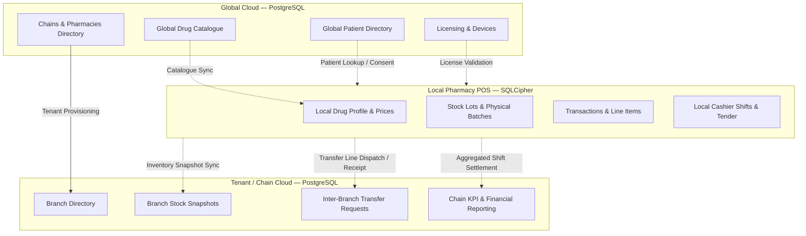

# Sops.Models — Architectural Blueprint & Boundary Model

## 1. Executive Summary

`Sops.Models` is the canonical, portable, cross-platform domain contract and schema library for the SOPs pharmacy ecosystem. It defines the universal language and wire contracts exchanged between:

1. **Global Cloud Services** (Global PostgreSQL — multi-tenant administrative master data, global drug catalogue, patient registry, licensing).
2. **Tenant / Chain Services** (Tenant PostgreSQL — isolated branch hierarchy, inventory snapshots, inter-branch stock transfers, consolidated KPI reporting).
3. **Local Offline-First Clients** (Local SQLCipher — desktop WPF POS, local drug inventory, local cashier shifts, sales transactions, dispensing, receipt printing).
4. **Cross-Platform Clients** (Flutter Mobile/Tablet, React Web Portals, ASP.NET Core APIs).

`Sops.Models` adheres strictly to **Domain-Driven Design (DDD)** and **Contract-First Design**. It contains data contracts, value objects, domain enums, and wire transfer schemas.

---

## 2. Fundamental Architectural Rule

To prevent architectural decay and dependency entanglement, four distinct model categories exist across the SOPs system:

```text
┌─────────────────────────────────────────────────────────────┐
│                   Category A: Shared Domain Contracts       │
│                         (Sops.Models)                       │
│  - Immutable / record DTOs                                  │
│  - JSON Schema definitions (schemas/v1/...)                 │
│  - Value Objects (Money, Quantity, AuditMetadata)           │
│  - Domain Enums (DosageForm, TransferStatus, PaymentMethod) │
└──────────────────────────────▲──────────────────────────────┘
                               │ maps to / from
        ┌──────────────────────┼──────────────────────┐
        │                      │                      │
┌───────┴──────────────┐ ┌─────┴────────────────┐ ┌────┴─────────────────┐
│     Category B       │ │         Category C   │ │         Category D   │
│ Persistence Entities │ │   Business Services  │ │  User Interface DTOs │
│ (Sops.Database, etc.)│ │  (POS Logic, Core)   │ │    (Sops.UI.Wpf)     │
│ - EF Core / Dapper   │ │ - Aggregates         │ │ - ViewModels         │
│ - Table mappings     │ │ - Domain logic       │ │ - INotifyPropertyChg │
│ - Foreign keys       │ │ - State mutations    │ │ - UI formatters      │
└──────────────────────┘ └──────────────────────┘ └──────────────────────┘
```

### Prohibited Responsibilities in `Sops.Models`
`Sops.Models` must NEVER contain:
- Database connection strings, SQL queries, or ORM annotations (Entity Framework Core `DbContext`, `TableAttribute`, etc.).
- Network transport logic (HTTP clients, WebSockets, SMTP, Meta WhatsApp clients).
- UI bindings or framework dependencies (WPF `DependencyObject`, XAML, Blazor, Flutter UI).
- State mutation engines (transaction processing, stock deduction, pricing engines).
- Private cryptographic secrets or sensitive credential storage (DPAPI, password hashes, encryption keys).

---

## 3. The Three Database Boundaries

The SOPs architecture separates concerns across three physical database boundaries:



1. **Global PostgreSQL**:
   - Master authority for the official Drug Catalogue (Egyptian EDA / International standards), official pricing regulations, master categories, global patient directory, device registrations, and licensing.
   - Never stores branch-level physical stock lot records or cash drawer balances.

2. **Tenant PostgreSQL**:
   - Master authority for paid pharmacy chain operations: tenant branches, consolidated inventory snapshots (projected, non-authoritative), inter-branch inventory transfer requests, and organizational financial KPIs.
   - Completely isolated per tenant (`TenantId`).

3. **Local SQLCipher**:
   - Master authority for local point-of-sale operational reality: local inventory lots (batches, expiry dates, purchase costs), local price overrides (within regulatory caps), cash shifts, retail sales transactions, and prescription dispensing.
   - Guaranteed full operational autonomy when disconnected from the internet.

---

## 4. Cross-Language & Interoperability Model

Contracts defined in `Sops.Models` are represented across three canonical ecosystems:
1. **JSON Schema (Draft 2020-12)**: Located in `schemas/v1/`, defining the source-of-truth structural specification.
2. **C# (.NET Standard 2.0 / .NET 8 / .NET 10)**: Located in `src/Sops.Models/`, compiled as a high-performance, immutable library.
3. **TypeScript**: Located in `src/typescript/`, providing strict type definitions for web applications and administrative dashboards.
4. **Dart**: Located in `src/dart/`, providing clean Dart models for mobile and tablet pharmacy applications.

All financial amounts are strictly modeled as integer minor units (`long AmountMinorUnits`) accompanied by an explicit ISO 4217 currency code (e.g., `"EGP"`, `"USD"`), completely eliminating floating-point rounding errors.
